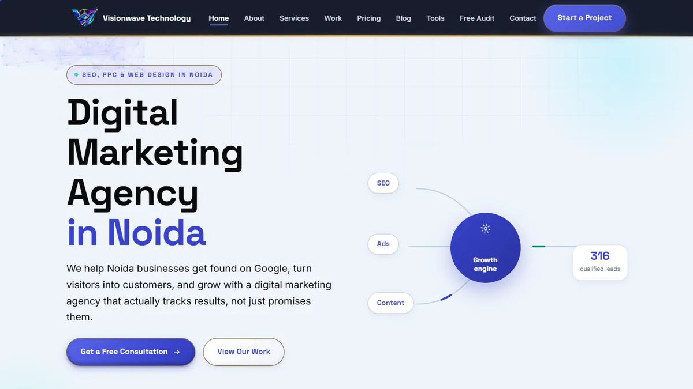
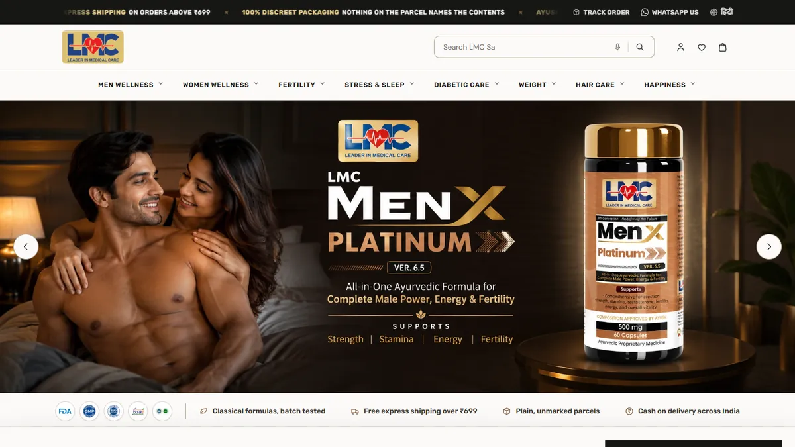
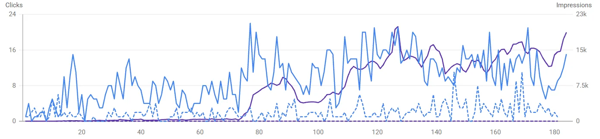

<!-- Header -->

  

  

  
  
  
  

 

  

## 👋 Hi, I'm Anek

Most businesses hire a developer for the website and then an agency for traffic. **I do both.**
I write the code (Python/Django or PHP + MySQL), then I run the SEO and the Meta & Google ads that fill it with leads.

- 🏢 **Now:** Full Stack Developer & Digital Marketing Specialist at **Shubharambh Infra Advisors**, Noida
- 📈 Grew the site from **3.43k → 1.22M Google impressions** in six months, **#1 on Google for 17 keywords**
- 🎯 **1,149 property leads** from Meta Ads at **₹288** each, about 1 in 10 became a site meeting
- 🧩 Built a **300+ module real-estate CRM** (PHP & MySQL) at Matrix Acres
- 🛠 **3+ years**, 4 companies, 7 live websites, open to freelance projects

  

## 🧰 Stack

  

  
  
  
  
  
  
  
  
  

## 🚀 Live work

<table>
  <tr>
    <td width="50%" valign="top">
      
      <h3>Shubharambh Infra Advisors</h3>
      Real-estate advisory site I built and run: project search, EMI calculator, 25 area-unit converters. 
      <b>#1 on Google for 17 keywords · 1.22M impressions · 1,149 leads</b>  
      
    </td>
    <td width="50%" valign="top">
      
      <h3>Matrix Acres</h3>
      Real-estate website plus a <b>300+ module CRM</b> (leads, dashboards, role-based access) and the Meta & Google campaigns that fed it.  
      
    </td>
  </tr>
  <tr>
    <td width="50%" valign="top">
      
      <h3>Visionwave Technology</h3>
      Digital agency website with 29 free tools.  
      
    </td>
    <td width="50%" valign="top">
      
      <h3>LMC Healthcare Store</h3>
      Ayurvedic wellness e-commerce store.  
      
    </td>
  </tr>
  <tr>
    <td width="50%" valign="top">
      
      <h3>Hari Sabzi Wala</h3>
      Grocery delivery website with a rider app.  
      
    </td>
    <td width="50%" valign="top">
      
      <h3>EzzyCommerce</h3>
      Streetwear fashion e-commerce.  
      
    </td>
  </tr>
</table>

  <a href="https://allfiles.space"><b>AllFiles</b></a> (private cloud storage + free tools) ·
  <a href="https://github.com/Anekkumar9518/echo-reminder"><b>Echo Reminder</b></a> (voice reminders app) ·
  more on <a href="https://www.anekkumar.in">anekkumar.in</a>

## 📈 Proof, not promises

  
   
  Real Google Search Console chart for shubharambhinfraadvisors.com · impressions climbing to 1.22M in six months

## 🐍 Contributions

  <picture>
    <source media="(prefers-color-scheme: dark)" srcset="https://raw.githubusercontent.com/Anekkumar9518/Anekkumar9518/output/github-snake-dark.svg" />
    <source media="(prefers-color-scheme: light)" srcset="https://raw.githubusercontent.com/Anekkumar9518/Anekkumar9518/output/github-snake.svg" />
    
  </picture>

## 🤝 Let's build something that sells

  Need a website that actually brings customers, SEO that ranks, or Meta ads that fill your CRM? 
  <a href="https://wa.me/919518848804?text=Hi%20Anek%2C%20I%20saw%20your%20GitHub"><b>WhatsApp me</b></a> ·
  <a href="mailto:anekkumar9518@gmail.com"><b>anekkumar9518@gmail.com</b></a> ·
  <a href="https://www.anekkumar.in"><b>anekkumar.in</b></a>

  

