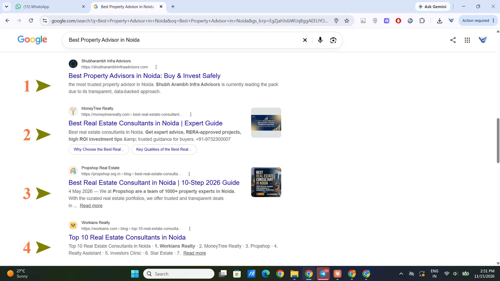
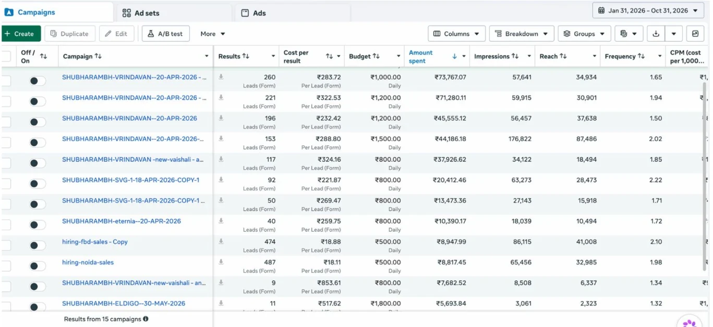
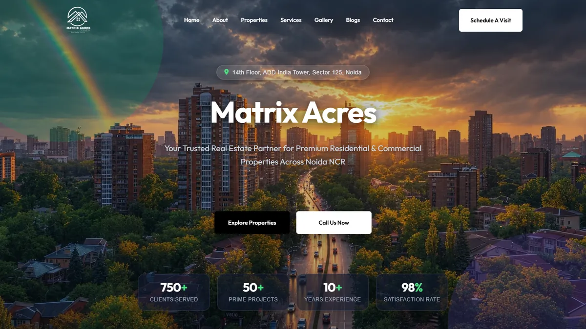
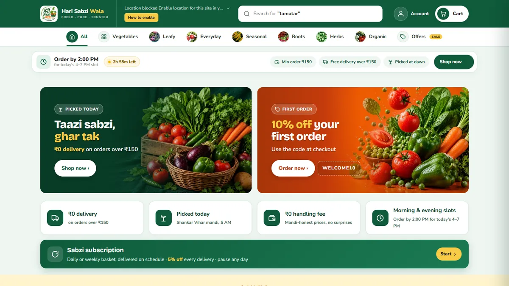
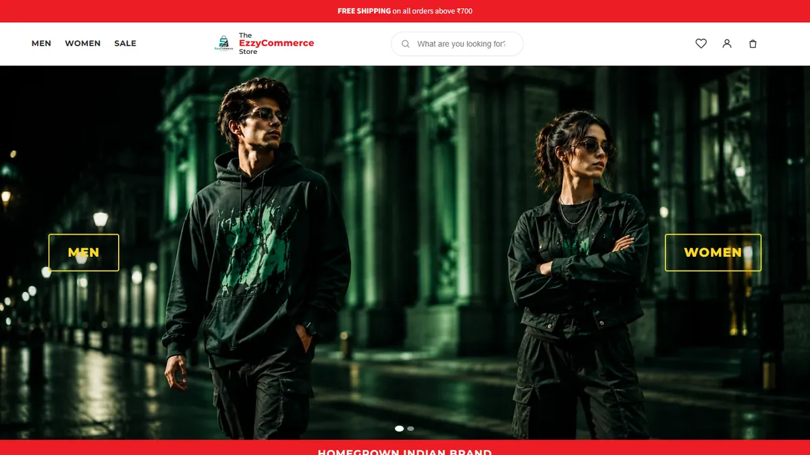

**I build websites, then I bring them customers.** Most businesses hire a developer for the website, then an agency for traffic. I do both: I write the code (Django, PHP, MySQL, React), then I run the SEO and the Meta ads that fill it with leads.
Right now that's **Shubharambh Infra Advisors** in Noida. Before that, Matrix Acres, Ryoto Electrix and Xaas Technologies.

[Portfolio](https://www.anekkumar.in) &nbsp;·&nbsp; [WhatsApp](https://wa.me/919518848804?text=Hi%20Anek%2C%20I%20saw%20your%20GitHub) &nbsp;·&nbsp; [anekkumar9518@gmail.com](mailto:anekkumar9518@gmail.com) &nbsp;·&nbsp; [CV](https://www.anekkumar.in/assets/cv/Anek-Kumar-CV.pdf)

 

 

 

### How the numbers happened

<b>How Shubharambh got to #1 on Google for 55 keywords</b> &nbsp;click to open

 

Six months of SEO on [shubharambhinfraadvisors.com](https://shubharambhinfraadvisors.com) took Google impressions from **3.43k to 1.22M** and clicks from **355 to 1.8k** (Google Search Console, Nov 2026). Rankings checked from Delhi NCR on 15 and 19 Nov 2026: 55 keywords at #1, 60 on page one.

- **Local SEO.** Pages written for searches like "best property advisor in Noida" and "real estate consultant in Noida". Both rank #1, above MoneyTree Realty, Propshop and Wealth Clinic, and the short search "property advisor in noida" ranks #1 above Justdial.
- **Project pages and a blog.** Pages for the projects and the questions buyers actually search. "Finding High-ROI Properties with Market Metrics" ranks #1, above M3M India and Investopedia.
- **Free property tools.** EMI, loan-eligibility and stamp-duty calculators, plus area and length converters that bring buyers in from search.
- **Technical SEO.** Speed, schema, clean URLs, sitemaps and indexing.
- **Research pages that outrank institutions.** The Indian real estate industry report ranks #1 above IBEF and Grant Thornton, the Central Delhi retail guide above Delhi Tourism, the Ganga Expressway piece above the UP Government's Invest UP site, and the Grade-A offices page above CBRE.
- **Guides Google quotes.** The Noida buyer's guide, "best builders in Noida" and "best areas to invest in Noida" pages rank #1 and are the top source in Google's AI Overview for those searches.

Semrush now counts 3.8K keywords ranking (+19% this month) and 2.3K referring domains (its own estimates, 18 Nov 2026).

Google search from Noida, 15 Nov 2026, 2:51 PM IST. Not edited.

<b>How Meta Ads brought in 1,149 property leads at ₹288 each</b> &nbsp;click to open

 

Facebook and Instagram lead-form campaigns for real estate projects in Vrindavan and Delhi NCR, run since March 2026.

| | |
|---|---|
| Ad spend | ₹3.30L across 10 campaigns |
| Leads | 1,149, each with a name and phone number |
| Cost per lead | ₹288 on average, ₹222 on the best campaign |
| Impressions | 505K, about 1 lead per 440 |
| Site meetings | about 115, roughly 1 in 10 leads |

- **Creatives.** Video hook rate up to 39.7%, hold rate up to 37.6%. Lowest property CPM ₹250.
- **Hiring too.** 961 job applicants at ₹18 each for sales roles in Noida and Faridabad, from 2 campaigns.

Meta Ads Manager, Shubharambh Infra Advisors account. Not edited.

<b>What's inside the 300+ module CRM at Matrix Acres</b> &nbsp;click to open

 

At Matrix Acres (Sep 2024 to Mar 2026) I built the company website, the in-house CRM behind it, and ran the Meta and Google lead campaigns that fed it.

- **The CRM.** 300+ modules: leads, sales tracking, reports, dashboards and role-based access for Admin, Manager and User. PHP and MySQL.
- **The website.** Property listings for M3M, Godrej and Dasnac projects, site-visit booking, lead forms, a blog and careers pages. Live at [matrixacres.in](https://www.matrixacres.in).

The CRM is an internal system, so there's no public link or screenshot.

 

### Live in production

<table>
  <tr>
    <td width="50%" valign="top">
      
       <code>01</code>&nbsp; <b>Shubharambh Infra Advisors</b> 
      Real-estate advisory site I built and still run. Project search, EMI calculator, 25 area-unit converters. #1 on Google for 55 keywords. 
      <a href="https://shubharambhinfraadvisors.com">shubharambhinfraadvisors.com ↗</a>
    </td>
    <td width="50%" valign="top">
      
       <code>02</code>&nbsp; <b>Matrix Acres</b> 
      The website, plus a 300+ module CRM behind it (leads, dashboards, roles) and the Meta and Google campaigns that fed it. 
      <a href="https://www.matrixacres.in">matrixacres.in ↗</a>
    </td>
  </tr>
  <tr>
    <td width="50%" valign="top">
      
       <code>03</code>&nbsp; <b>Visionwave Technology</b> 
      Agency website with 29 free tools. 
      <a href="https://visionwavetechnology.com">visionwavetechnology.com ↗</a>
    </td>
    <td width="50%" valign="top">
      
       <code>04</code>&nbsp; <b>LMC Healthcare Store</b> 
      Ayurvedic wellness e-commerce. 
      <a href="https://lmcstore.in">lmcstore.in ↗</a>
    </td>
  </tr>
  <tr>
    <td width="50%" valign="top">
      
       <code>05</code>&nbsp; <b>Hari Sabzi Wala</b> 
      Grocery delivery website with a rider app. 
      <a href="https://harisabziwala.com">harisabziwala.com ↗</a>
    </td>
    <td width="50%" valign="top">
      
       <code>06</code>&nbsp; <b>EzzyCommerce</b> 
      Streetwear fashion e-commerce. 
      <a href="https://ezzycommerce.store">ezzycommerce.store ↗</a>
    </td>
  </tr>
</table>

### Open source

**AK Phone** is an Android-style phone that runs in a web page: 28 working apps and 9 games in plain HTML, CSS and JavaScript, with no framework and no build step. It has a live browser, voice assistant, recorder, translation, live currency rates, a QR scanner and a speed test.
[Try it live](https://anekkumar9518.github.io/ak-phone/) · [Source](https://github.com/Anekkumar9518/ak-phone)

**DevTab** is a new tab for Chrome with two looks, Developer and Hacker: a live sky with your city's real weather, a particle clock, your GitHub year as a 3D city, search shortcuts (`g react` searches GitHub), to-dos with reminders and a pet that eats ads and evolves. Its page tools work on any website:

- **Website X-ray:** hover any element to see its box model, fonts and colours, then copy it as a clean, standalone HTML + CSS component.
- **Price & change tracker:** watch a price or any text and get a notification when it changes, with price graphs.
- **Tech stack detector, full-page screenshots with an editor, a website time machine** and an image and video downloader.
- **Focus mode** that blocks distracting sites, a **tab sleeper**, news, ambient sounds and workspaces.

Plain JavaScript, Manifest V3, no tracking.
[Try the demo](https://anekkumar9518.github.io/devtab/) · [Install](https://github.com/Anekkumar9518/devtab/releases/latest) · [Source](https://github.com/Anekkumar9518/devtab)

 

Also: [AllFiles](https://allfiles.space), a private cloud with free tools, and [Echo Reminder](https://github.com/Anekkumar9518/echo-reminder), voice reminders with smart repeats.

 

### Commits, eaten

<picture>
  <source media="(prefers-color-scheme: dark)" srcset="https://raw.githubusercontent.com/Anekkumar9518/Anekkumar9518/output/github-snake-dark.svg" />
  <source media="(prefers-color-scheme: light)" srcset="https://raw.githubusercontent.com/Anekkumar9518/Anekkumar9518/output/github-snake.svg" />
  
</picture>

 

Every card above is hand-built SVG (see <a href="./tools/build_svgs.py">tools/build_svgs.py</a>), and every number comes from Google Search Console, Meta Ads Manager or Semrush, Nov 2026. The terminal in the top card is a real health check of the six sites, re-run every morning by <a href="./.github/workflows/status.yml">a GitHub Action</a>.
