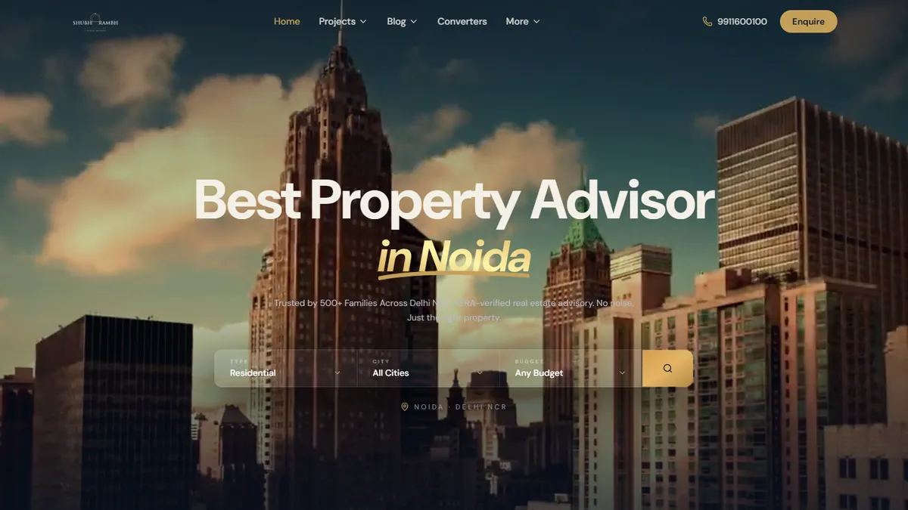

Most businesses hire a developer for the website, then an agency for traffic. I do both: I write the code (Django, PHP, MySQL, React), then I run the SEO and the Meta ads that fill it with leads.
Right now that's **Shubharambh Infra Advisors** in Noida. Before that, Matrix Acres, Ryoto Electrix and Xaas Technologies.

[Portfolio](https://www.anekkumar.in) &nbsp;·&nbsp; [WhatsApp](https://wa.me/919518848804?text=Hi%20Anek%2C%20I%20saw%20your%20GitHub) &nbsp;·&nbsp; [anekkumar9518@gmail.com](mailto:anekkumar9518@gmail.com) &nbsp;·&nbsp; [CV](https://www.anekkumar.in/assets/cv/Anek-Kumar-CV.pdf)

 

 

 

### Work that's live right now

<table>
  <tr>
    <td width="50%" valign="top">
      
       <code>01</code>&nbsp; <b>Shubharambh Infra Advisors</b> 
      Real-estate advisory site I built and still run. Project search, EMI calculator, 25 area-unit converters. #1 on Google for 17 keywords. 
      <a href="https://shubharambhinfraadvisors.com">shubharambhinfraadvisors.com ↗</a>
    </td>
    <td width="50%" valign="top">
      
       <code>02</code>&nbsp; <b>Matrix Acres</b> 
      The website, plus a 300+ module CRM behind it (leads, dashboards, roles) and the Meta and Google campaigns that fed it. 
      <a href="https://www.matrixacres.in">matrixacres.in ↗</a>
    </td>
  </tr>
  <tr>
    <td width="50%" valign="top">
      
       <code>03</code>&nbsp; <b>Visionwave Technology</b> 
      Agency website with 29 free tools. 
      <a href="https://visionwavetechnology.com">visionwavetechnology.com ↗</a>
    </td>
    <td width="50%" valign="top">
      
       <code>04</code>&nbsp; <b>LMC Healthcare Store</b> 
      Ayurvedic wellness e-commerce. 
      <a href="https://lmcstore.in">lmcstore.in ↗</a>
    </td>
  </tr>
  <tr>
    <td width="50%" valign="top">
      
       <code>05</code>&nbsp; <b>Hari Sabzi Wala</b> 
      Grocery delivery website with a rider app. 
      <a href="https://harisabziwala.com">harisabziwala.com ↗</a>
    </td>
    <td width="50%" valign="top">
      
       <code>06</code>&nbsp; <b>EzzyCommerce</b> 
      Streetwear fashion e-commerce. 
      <a href="https://ezzycommerce.store">ezzycommerce.store ↗</a>
    </td>
  </tr>
</table>

Also: [AllFiles](https://allfiles.space), a private cloud with free tools, and [Echo Reminder](https://github.com/Anekkumar9518/echo-reminder), voice reminders with smart repeats.

 

 

### Commits, eaten

<picture>
  <source media="(prefers-color-scheme: dark)" srcset="https://raw.githubusercontent.com/Anekkumar9518/Anekkumar9518/output/github-snake-dark.svg" />
  <source media="(prefers-color-scheme: light)" srcset="https://raw.githubusercontent.com/Anekkumar9518/Anekkumar9518/output/github-snake.svg" />
  
</picture>

 

Every card above is hand-built SVG (see <a href="./tools/build_svgs.py">tools/build_svgs.py</a>), and every number comes from Google Search Console, Meta Ads Manager or Semrush, Nov 2026.
